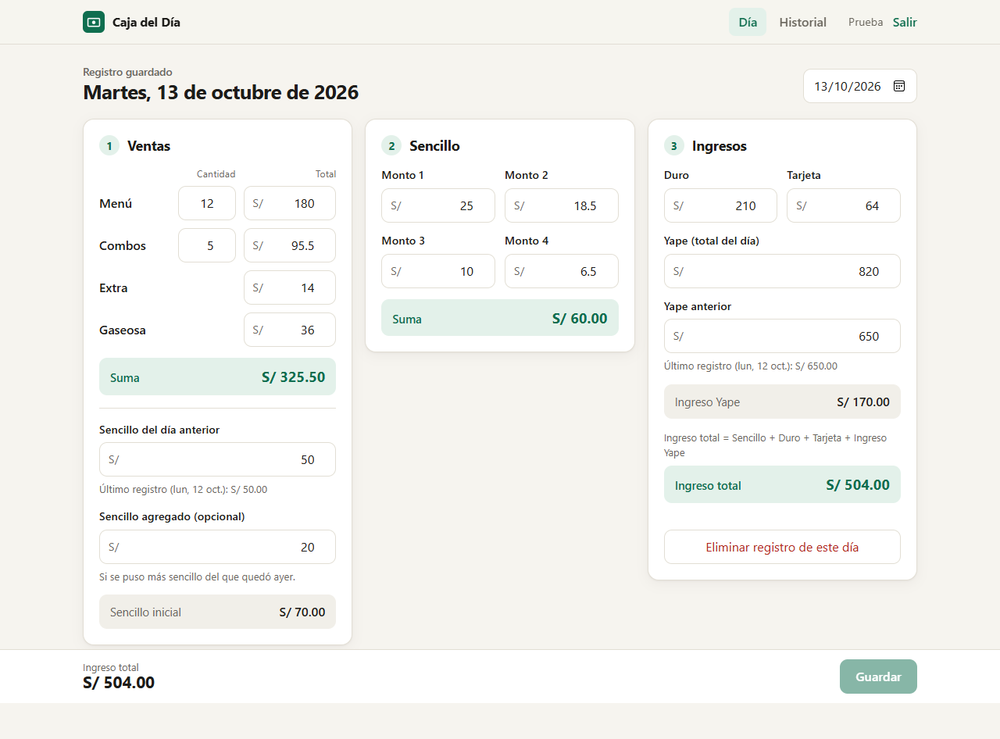
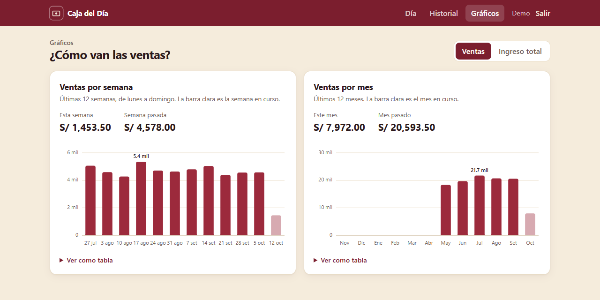
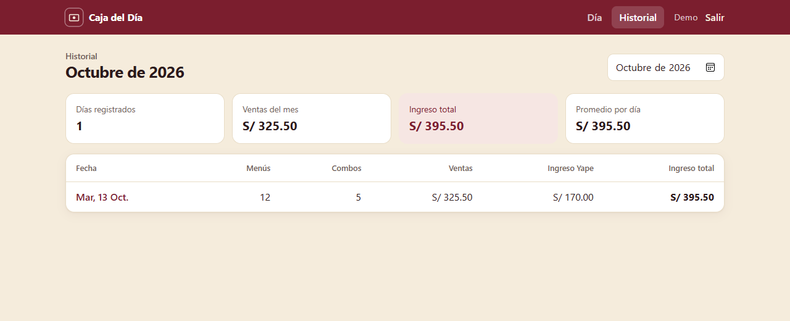
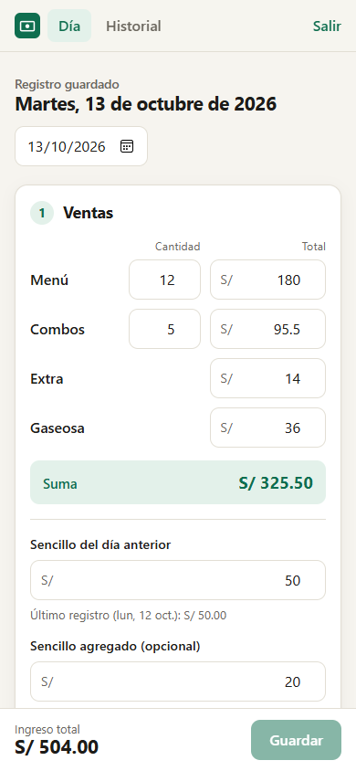

# Caja del Día

**[Ver demo en línea →](https://caja-del-dia.onrender.com)** *(plan gratuito: si estuvo inactiva, la primera carga tarda alrededor de un minuto)*

Aplicación web para registrar las ventas diarias y cuadrar la caja de un negocio de comida. Reemplaza el cuaderno donde se anotaban a mano los menús, combos, el sencillo, el efectivo, la tarjeta y Yape: los totales se calculan solos y cada día queda guardado en una base de datos con su historial.

<p align="center">
  
</p>

## Funcionalidades

- **Cuentas de usuario** con registro e inicio de sesión. Las contraseñas se guardan con hash bcrypt y la sesión va en una cookie `httpOnly`.
- **Registro del día en tres apartados**:
  1. **Ventas**: menús y combos (cantidad y total), extra y gaseosa, con la suma automática. Además, el sencillo del día anterior (se autocompleta) y el sencillo agregado. Al final aparece el **total de ventas + sencillo**, que se compara con el ingreso total para saber si la caja cuadra.
  2. **Sencillo**: cuatro montos que se suman.
  3. **Ingresos**: duro, tarjeta y Yape. El **ingreso Yape** es el Yape del día menos el Yape anterior (se autocompleta y se puede corregir si se gastó dinero de ahí). El **ingreso total** es sencillo + duro + tarjeta + ingreso Yape.
- **Totales en vivo** mientras se escribe, y aviso de cambios sin guardar.
- **Historial mensual** con días registrados, ventas del mes, ingreso total y promedio por día. Cualquier día se puede abrir y corregir.
- **Exportación a Excel y PDF** del mes, y una copia de seguridad de todo el historial en Excel. El Excel trae fórmulas de totales y formato de soles; el PDF es un reporte listo para imprimir.
- **Gráficos de ventas por semana y por mes** (últimos 12 periodos), con detalle al tocar cada barra y una vista en tabla accesible. Los totales se agregan en PostgreSQL con `generate_series`, así que los periodos sin ventas aparecen en 0.
- **Diseño adaptable** al celular, con los colores del restaurante (crema, guinda y blanco).
- **Instalable como app (PWA)** en Android e iPhone: ícono en la pantalla de inicio y pantalla completa, sin pasar por las tiendas de apps.

<p align="center">
  
</p>

<p align="center">
  
  &nbsp;
  
</p>

## Tecnologías

| Capa | Tecnología |
|---|---|
| Frontend | React 19, React Router, Vite, gráficos en SVG propio |
| Reportes | ExcelJS, jsPDF (cargados bajo demanda) |
| Backend | Node.js, Express 5 |
| Base de datos | PostgreSQL 16 |
| Seguridad | bcrypt, JWT en cookie httpOnly, Helmet, rate limiting en el login, validación con Zod |
| Pruebas | `node:test` |

## Decisiones de diseño

- **La lógica de cálculo vive en un solo módulo** ([`shared/calculos.js`](shared/calculos.js)), usado por el frontend y cubierto por pruebas.
- **PostgreSQL también calcula los totales** con columnas generadas (`GENERATED ALWAYS AS ... STORED`). Así los reportes y el historial salen directo de SQL y no pueden quedar desincronizados.
- **El dinero se guarda como `NUMERIC(12,2)`**, nunca como `float`, y la base de datos rechaza montos negativos con restricciones `CHECK`.
- **Un registro por usuario y por día** (`UNIQUE (usuario_id, fecha)`): guardar dos veces el mismo día actualiza el registro en lugar de duplicarlo.
- **Las fechas se manejan como texto `AAAA-MM-DD`** para evitar los desfases de zona horaria típicos de `Date`.

## Instalación local

Requisitos: **Node.js 20+** y **PostgreSQL 14+**.

```bash
# 1. Clonar e instalar dependencias
git clone https://github.com/BenJfet/registro-de-cuentas.git
cd registro-de-cuentas
npm install

# 2. Crear la base de datos
createdb -U postgres registro_cuentas

# 3. Configurar variables de entorno
cp .env.example .env    # y completa DATABASE_URL y JWT_SECRET

# 4. Crear las tablas
npm run db:migrate

# 5. Levantar la API (puerto 3001) y la web (puerto 5173)
npm run dev
```

Abre http://localhost:5173, crea una cuenta y empieza a registrar.

### Despliegue

La app está preparada para **Render** (servidor) y **Neon** (PostgreSQL), con la configuración en [`render.yaml`](render.yaml). En producción, Express sirve la API y la web compilada desde el mismo dominio, y `/api/salud` sirve de *health check*.

### Scripts

| Comando | Descripción |
|---|---|
| `npm run dev` | API y frontend en modo desarrollo |
| `npm run db:migrate` | Crea o actualiza las tablas |
| `npm test` | Ejecuta las pruebas |
| `npm run build` | Compila el frontend para producción |
| `npm start` | Servidor de producción (sirve la API y la web compilada) |

## API

Todas las rutas de `/api/registros` requieren sesión.

| Método | Ruta | Descripción |
|---|---|---|
| `POST` | `/api/auth/registro` | Crear cuenta |
| `POST` | `/api/auth/login` | Iniciar sesión |
| `POST` | `/api/auth/logout` | Cerrar sesión |
| `GET` | `/api/auth/yo` | Usuario actual |
| `GET` | `/api/registros?mes=AAAA-MM` | Registros de un mes |
| `GET` | `/api/registros/resumen?periodo=semana\|mes&cantidad=12&hasta=AAAA-MM-DD` | Totales por semana o por mes |
| `GET` | `/api/registros/exportar[?mes=AAAA-MM]` | Todos los campos, de un mes o de todo el historial |
| `GET` | `/api/registros/:fecha` | Registro de un día y datos del día anterior para autocompletar |
| `PUT` | `/api/registros/:fecha` | Crear o actualizar el registro del día |
| `DELETE` | `/api/registros/:fecha` | Eliminar el registro del día |

## Estructura

```
├── client/            Frontend React (Vite)
│   └── src/
│       ├── paginas/       Acceso, Día, Historial, Gráficos
│       ├── componentes/   Layout, Campo, GraficoBarras
│       └── exportar.js    Excel y PDF
├── server/            API Express
│   ├── auth.js            Registro, login y sesión
│   ├── registros.js       CRUD de registros diarios
│   └── db/                Conexión, esquema SQL y migración
└── shared/            Lógica de cálculo compartida + pruebas
```

---

Desarrollado por **Benjamin** · [GitHub](https://github.com/BenJfet)
